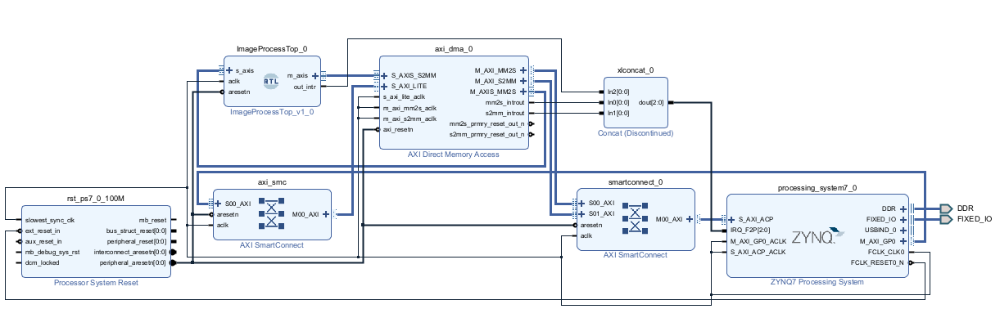

# zynq-image-processing

A streaming 3×3 image convolution core written in Verilog, verified with a
UVM testbench against a Python reference model, and run on a Zynq-7000
(Digilent Arty Z7-20) through AXI DMA. Vivado builds the hardware and Vitis
builds the bare-metal firmware; both projects are generated from this repo by
scripts.

The core uses AXI4-Stream Video (`tuser` = start of frame, `tlast` = end of
line) and processes one pixel per clock, so it is designed to sit in a live
video pipeline as well as the DMA test harness used here.

---

## Features

- **Five kernels, selectable at run time** — sharpen, box blur, Gaussian blur,
  edge detect and identity (bypass), chosen by the `CTRL` register over
  AXI4-Lite or by board switches `sw[1:0]`. The selection is latched at the
  start of each frame, so every frame uses a single kernel.
- **Same-size output with border handling** — a W×H frame in gives a W×H frame
  out; edge pixels are replicated at the borders.
- **Correct rounding without dividers** — every kernel is built from three
  sums (centre, edge neighbours, corners). Blur normalisation uses a shift
  (÷16) and a reciprocal multiply (÷9), proven equal to exact
  round-half-up division for every reachable value.
- **Saturating output** — results are clamped to \[0, 255\].
- **Full AXI4-Stream flow control** — honours `tready` on both sides. A credit
  counter on the output FIFO means the pipeline never stalls and never
  overflows, and `s_axis_tready` depends only on registers.
- **One pixel per clock** — plus one idle input cycle per line and one idle
  line per frame, which fit inside video blanking.
- **Parameterised** — `WIDTH`, `HEIGHT`, `CHANNELS` (1 = 8-bit grey, 3 = RGB).
- **Frame-sync checking** — a misplaced `tlast` or a mid-frame `tuser` sets a
  sticky error bit; a new `tuser` always restarts cleanly.
- **UVM testbench** — agent, driver, monitor, back-pressure sink and
  scoreboard, checking every output pixel bit-exactly against the reference
  model, plus sideband, register, interrupt and throughput checks.

---

## Architecture

```
            AXI4-Stream Video in (tuser = SOF, tlast = EOL)
                         │
                   ┌─────▼──────┐  two block-RAM line buffers + 3×3 window
                   │ WindowGen  │  replicate-edge borders
                   │            │  frame sync, kernel latched per frame
                   └─────┬──────┘
                         │ 3×3 window + kernel code
                   ┌─────▼──────┐  centre / edge / corner sums
                   │    Conv    │  kernel select, rounding, clamp
                   │            │  4-stage pipeline
                   └─────┬──────┘
                         │ pixel
                   ┌─────▼──────┐  32-deep FIFO; credits gate new input
                   │ OutputFifo │  so the pipeline never stalls
                   └─────┬──────┘
                         │
            AXI4-Stream Video out

            ControlRegs: AXI4-Lite CTRL / STATUS / FRAMES / INFO
```

On the Zynq, `AxisFramer` and `AxisDeframer` (`rtl/harness/`) adapt the AXI
DMA's one-transfer-per-frame streams to and from the video protocol:

```
DDR ─ AXI DMA MM2S ─ AxisFramer ─ ImageProcessTop ─ AxisDeframer ─ AXI DMA S2MM ─ DDR
```

### Control registers (`s_axi_ctrl`, base `0x43C00000` in the block design)

| Offset | Name | Bits |
|---|---|---|
| `0x00` | CTRL | `[0]` kernel source (0 switches, 1 register), `[6:4]` kernel: 0 sharpen, 1 box, 2 Gaussian, 3 edge, 4 identity |
| `0x04` | STATUS | `[0]` sync error (sticky, write 1 to clear), `[1]` frame in progress |
| `0x08` | FRAMES | frames output since reset |
| `0x0C` | INFO | `[15:0]` width, `[31:16]` height |

---

## Repository Structure

```
zynq-image-processing/
├── rtl/          synthesisable Verilog (core); rtl/harness/ DMA adapters
├── tb/           UVM testbench, DMA harness test, sample image
├── bd/           block design as a Tcl script (write_bd_tcl)
├── constraints/  pin constraints
├── firmware/     Vitis bare-metal application
├── scripts/      build, simulation, reference model and hardware test scripts
├── docs/         supplementary documentation
└── README.md
```

---

## Simulation

```bat
python scripts/sim/run_sim.py            :: full regression (~11 min)
python scripts/sim/run_sim.py --list     :: list tests
python scripts/sim/run_sim.py --waves small_stress
```

`run_sim.py` drives Vivado's simulator directly (no project needed). For each
test it generates stimulus and the expected output of every frame with
`scripts/golden_conv.py`, compiles the design once per frame size, runs the
UVM testbench and checks the report. Tests cover every kernel, back-to-back
frames, random input gaps and output back-pressure, mid-frame kernel changes
(applied from the next frame), switch control, frame-sync errors, a
non-power-of-two size, RGB, 512×512 images and 720p RGB at full rate. Results
are in `build/sim/<test>/`, including viewable `out_f<N>.bmp` images for the
512×512 tests.

*UVM was chosen over a basic self-checking testbench to build familiarity
with the component hierarchy and methodology used in industry verification
environments. For a design of this size it is admittedly heavier than
necessary, but the structure scales cleanly to more complex designs.

---

## Build and run on hardware

Requires Vivado and Vitis 2025.2 and Python 3 with `pyserial`. From the repo
root, with the board connected over USB:

```bat
vivado -mode batch -source scripts/vivado/create_project.tcl   :: project from repo sources
vivado -mode batch -source scripts/vivado/build.tcl            :: bitstream + XSA (fails if timing is not met)
vitis  -s scripts/vitis/build_app.py                           :: platform + firmware
xsdb   scripts/hw/program.tcl                                  :: program over JTAG and run
python scripts/hw_test.py                                      :: every kernel, checked against the model
```

The Vivado and Vitis projects are generated into `build/` (not tracked);
sources are referenced from the repo, so edits made in either IDE land in the
repo. `scripts/vivado/synth_core.tcl` checks the core's timing on its own.

`hw_test.py` sends `tb/input.bmp` (or `--input`) to the board, receives the
result and compares it bit-exactly with the reference model. Images must be
512×512 8-bit greyscale BMPs; `scripts/format_image.py` converts other images.

---

## Results

| | |
|---|---|
| Hardware test (Arty Z7-20) | 50/50 frames bit-exact against the reference model (5 kernels × 10 frames, 512×512) |
| Processing time per 512×512 frame | 2.64 ms in the PL (263,169 cycles at 100 MHz: one pixel per clock plus the border slots) |
| System timing, 100 MHz | met, WNS +2.338 ns |
| Core alone, 150 MHz (out of context) | 720p RGB: WNS +0.458 ns (≈161 MHz); 512×512 grey: WNS +0.762 ns (≈169 MHz) |
| Core resources, 512×512 grey | 277 LUTs, 362 flip-flops, 1 block RAM, 1 DSP |
| Simulation | 11/11 tests pass, including 720p RGB at full rate (923,601 cycles per frame, within 720p60's 1,237,500) |

The round trip on hardware is about 5.7 s per frame, almost all of it the
921600-baud UART transfer.

---

## PS-PL System Integration


*Vivado block design — the AXI DMA streams frames from DDR through AxisFramer,
ImageProcessTop and AxisDeframer and back; the PS controls the core over
AXI4-Lite.*

---

## Hardware Target

| | |
|---|---|
| Board | Digilent Arty Z7-20 |
| SoC | Xilinx Zynq-7000 (XC7Z020) |
| RTL toolchain | Vivado 2025.2 |
| Firmware | Vitis 2025.2 |
